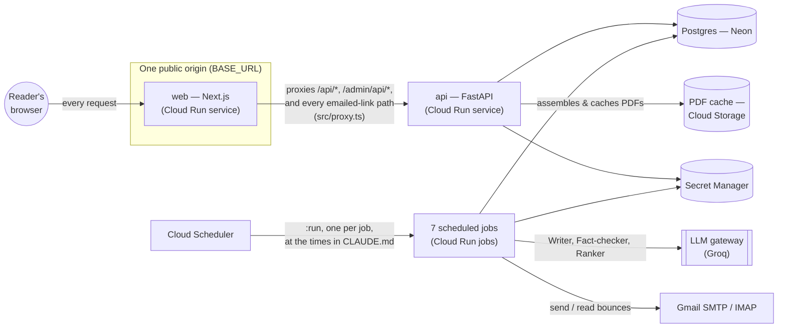
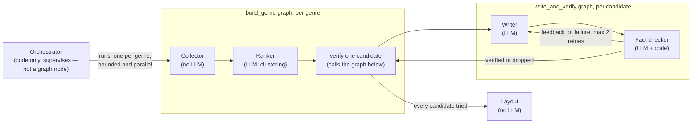

# Architecture

What exists today, how the pieces fit, and where the seams are. For the
day-to-day list of what's missing or provisional, see `docs/BACKLOG.md`;
for a specific decision's reasoning, see `docs/adr/`.

## System overview



Two Cloud Run services, seven Cloud Run jobs, one Postgres database, one LLM
gateway. `web` is the only thing a browser or an email client ever talks
to — see [ADR 0002](adr/0002-web-is-the-single-public-origin.md) for why
there is no load balancer here despite two backend services existing.

## The daily schedule

Every time below is IST, matching `infra/cloud_scheduler.tf` exactly. Bar
length below is each job's deadline window where CLAUDE.md gives one
(build, late update); it is not a measured runtime.

```mermaid
gantt
    dateFormat  HH:mm
    axisFormat  %H:%M
    section Jobs
    raw-text purge           :milestone, 03:00, 0m
    feedback aggregation     :milestone, 04:00, 0m
    bounce processing        :milestone, 05:00, 0m
    build (deadline 05:30)   :04:15, 75m
    late update (deadline 05:55) :05:35, 20m
    late update (deadline 07:25) :07:05, 20m
    delivery                 :milestone, 06:00, 0m
    delivery                 :milestone, 06:30, 0m
    delivery                 :milestone, 07:00, 0m
    delivery                 :milestone, 07:30, 0m
    delivery                 :milestone, 08:00, 0m
    delivery                 :milestone, 08:30, 0m
    delivery                 :milestone, 09:00, 0m
    failure notice           :milestone, 09:05, 0m
```

1. **Raw-text purge** (03:00) clears `Article.raw_text` for articles fetched
   more than 30 days ago (`app/jobs/purge.py`), per CLAUDE.md's retention
   promise. Never touches the audit trail: published sentences, their
   citations' frozen excerpts, and source URLs live in `SentenceCitation`,
   not in `Article.raw_text`.
2. **Feedback aggregation** (04:00) folds the previous day's thumbs up/down
   into per-user topic preferences (`user_preferences`).
3. **Bounce processing** (05:00) reads delivery-failure messages from the
   sender's own inbox over IMAP and marks addresses `bounced`, before the
   day's sends.
4. **Build** (04:15, hard deadline 05:30) runs the agent pipeline per genre
   in parallel and publishes the day's first `edition_revision`. If it
   fails, CLAUDE.md allows a manual rerun until 07:30 — today that means an
   operator re-invoking the Cloud Run job directly (`gcloud run jobs
   execute mosaic-build`); the admin dashboard has no "rerun the build"
   button of its own yet.
5. **Late update** (05:35 and 07:05, 20-minute windows) re-collects
   breaking stories for genres worth revisiting and publishes a new
   revision that carries every unchanged section forward byte for byte.
   Never touches a day with no revision yet, and publishes nothing if its
   deadline passes mid-assembly.
6. **Delivery** (every 30 minutes, 06:00–09:00) sends to readers whose slot
   is due, using whatever revision is newest at the moment each run
   starts — so a 09:00 reader can get content a 06:00 reader's late update
   added.
7. **Failure notice** (09:05, after the last delivery run) sends a
   build-independent apology to anyone who should have received an edition
   and didn't.

## The agent pipeline (build and late update)

Two real LangGraph graphs, not a diagram of one: `app/graph/build_genre.py`
runs one genre's collect -> rank -> verify-every-candidate pipeline, and
`app/graph/write_and_verify.py` is the Writer/Fact-checker retry loop it
calls once per pooled candidate. The Orchestrator (agent 1) supervises the
per-genre graph — deciding which genres run, running them in parallel,
isolating one genre's exception from the rest — rather than being a node
inside it; it has never made an LLM call, and CLAUDE.md's agent table
lists it as code-only to match.



Personalization happens after this, in plain code, at delivery time:
selecting and ordering already-verified stories per reader from keyword
matches, learned preferences, and edition preference — never a second LLM
call per reader. See CLAUDE.md's "No per-user LLM generation."

## The grounding chain

CLAUDE.md's non-negotiable principle — every factual statement traces to a
fetched source — is a data model, not just a prompt instruction:

```
Article (raw text, purged after 30 days)
  └─ Passage (numbered chunk, citable as "a1:p3")
       └─ Sentence (what's actually published)
            └─ Citation → the exact passage it relied on (frozen text, kept permanently)
                 └─ FactCheck (verdict: supported / unsupported / partial, and who checked — model or code)
```

Numbers, dates, and names are checked twice, independently: `unsupported_facts`
(`app/agents/checking.py`) compares them against cited passages with no
model involved, and the Fact-checker's own LLM call judges each claim's
meaning. Either can fail a sentence; a headline or summary failure drops
the whole story, an optional element's failure drops just that element.
`evals/fact_checker_catch_rate.py` measures this against planted errors.

## Reader-facing surfaces

| Path | Served by | Notes |
|---|---|---|
| `/`, `/signup`, `/archive`, `/preferences`, `/admin`, `/status` | `web` | React pages. |
| `/api/*`, `/admin/api/*` | `api`, via `web`'s proxy | JSON. |
| `/opt-in/*`, `/unsubscribe/*`, `/feedback/*`, `/pdf/*`, `/login/*`, `/admin/login/*` | `api`, via `web`'s proxy | Emailed links; GET renders, POST acts (link-scanner safety) — RFC 8058 one-click unsubscribe is the one POST-only exception. |

Two independent session systems, deliberately not shared code beyond the
double-submit CSRF *pattern*: a reader's session (`app/api/session.py`)
and an admin session (`app/api/admin_session.py`) use different cookie
names, different token purposes, and different signing subjects (a user id
vs. the allowlisted admin email), so neither can be replayed as the other.

A reader's session token still carries its own signature and expiry, but is
no longer purely stateless: it also names a row in `user_sessions`, checked
on every request, so logout or account deletion can revoke it before its
30-day expiry actually arrives — see `docs/BACKLOG.md` for the fix and how
it was verified (a captured cookie replayed after logout, not just checking
the browser's copy was cleared). The admin session is unchanged and stays
purely stateless — its 12-hour TTL (versus a reader's 30 days) was already
the accepted mitigation for the same gap, reasoned to be short enough that
adding the same machinery wasn't worth it.

## Data model, in five groups

- **Users and subscriptions** — `users`, `cities`, `user_genres`,
  `followed_keywords`, `consents`, `waitlist`, `user_preferences`,
  `tokens` (opt-in / magic-link / unsubscribe, hashed).
- **Content and the audit trail** — `sources`, `articles`,
  `story_clusters`, `stories`, `story_sentences`, `sentence_citations`,
  `story_tags`, `fact_checks`, `corrections`, `story_withdrawals`,
  `images`, extras tables, `weather_cache`, `weekend_features` (Saturday's
  longer reads and the weekend quiz; Sunday's weekly recap and quiz —
  `app/render/weekend.py`).
- **Editions and delivery** — `editions`, `edition_revisions` (immutable
  once published), `edition_sections`, `deliveries` (unique on
  `user_id, edition_date, type`; a `sent` newsletter must record which
  revision), `outage_state`, `feedback`.
- **Operations** — `pipeline_runs` (every job execution, its status and a
  JSON detail blob), `llm_calls` (token usage, latency, failures — never
  personal data, since none is ever sent to a model), `notice_batches`
  (held / approved / suppressed / expired / sent), `site_status` (a
  singleton row; `GET /api/status` reads it, an admin flips it manually —
  no automated detection exists yet).
- Feedback and PDF links use signed stateless tokens instead of stored
  rows, by design — see `app/email/tokens.py`'s module docstring.

## Infrastructure

- **Compute:** Cloud Run — two services (`web`, `api`), seven jobs sharing
  one backend image (`backend/Dockerfile`; the command differs per
  resource, set in Terraform, not baked into the image).
- **Scheduling:** Cloud Scheduler calls each job's `:run` endpoint on the
  Cloud Run Admin API directly (there's no HTTP endpoint to hit the way a
  Service has one), authenticated as a dedicated invoker service account.
- **Storage:** Postgres on Neon (external to GCP — CLAUDE.md's own choice,
  not Cloud SQL), a Cloud Storage bucket for assembled PDFs (30-day
  lifecycle), Artifact Registry for both images.
- **Secrets:** Secret Manager holds every credential in
  `app/config/settings.py`; Terraform creates the containers, never a
  value — see `infra/README.md`.
- **Identity:** four service accounts (`web`, `api`, `jobs`, `scheduler`),
  least-privilege by workload rather than one shared default account.
- **Monitoring:** two Cloud Monitoring alert policies today (a failed job
  execution, an api 5xx rate), both real, both against Cloud Run's own
  built-in metrics — see `docs/BACKLOG.md` for the two CLAUDE.md also asks
  for (deadline misses, a sharp drop in verified story counts) that need
  structured logging or a custom metric neither of which exist yet.
- **Observability:** structured JSON logs (`structlog`, `app/logging_config.py`)
  from every job's `main()` and the API, to stdout, where Cloud Logging
  parses them automatically. Every LLM call's metadata — agent, model,
  provider, token counts, latency, status — is recorded twice,
  independently: the `llm_calls` table always, and Langfuse
  (`app/llm/langfuse_recorder.py`) whenever it's configured, joining the
  database recorder rather than replacing it. Metadata only, never message
  content, for either.

None of the above has been applied anywhere: there is no GCP project. See
`docs/BACKLOG.md`'s Blockers for the full list, and `infra/README.md` for
exactly what has and hasn't been verified in place of a real deployment
(both Dockerfiles are built and run for real; Terraform is `validate`d,
not `apply`d; the CI workflows pass `actionlint` and every command they run
was executed locally, but none has run on GitHub's own infrastructure —
there's no git remote yet either).

## Where to look next

- A specific route or job's behaviour: the module's own docstring is
  usually the most precise source — this project treats "why", not just
  "what", as documentation, and keeps it next to the code it explains.
- A specific decision: `docs/adr/`.
- What's known to be incomplete, wrong, or provisional: `docs/BACKLOG.md`.
- An incident: `docs/runbooks/incident-response.md`.
